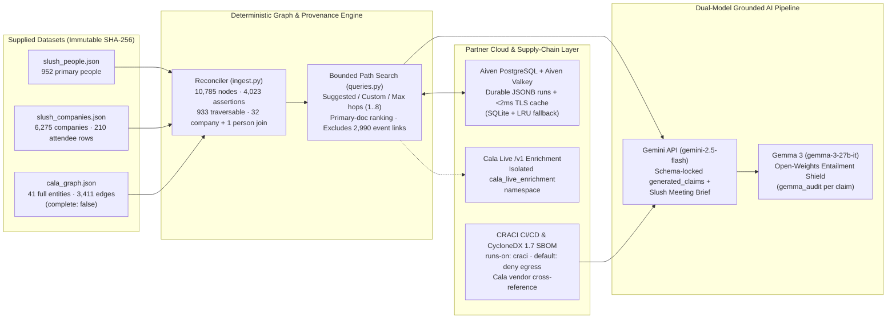

#FOR ACCESS, OPEN THIS LINK
> https://cala-junction-hack.niccolo-sobrero.workers.dev/


# Unicorn Radar — Cala × Slush 2026 Verified Connection Intelligence

> *"Make Unicorns Real — separating the unicorns from the horses"* · **Hackjunction 2026**

**Unicorn Radar** is a zero-confabulation, provenance-locked connection intelligence engine and Slush 2026 executive briefing webapp built on the **Cala Knowledge Graph** and supplied Slush 2026 event datasets.

At high-signal founder and investor events like Slush, generic AI networking tools fail in two ways: they **hallucinate warm introductions** from shared event attendance or unverified name collisions, and they **conflate directory listings with confirmed physical presence**. Unicorn Radar solves this by combining deterministic multi-source graph reconciliation (`ev:...` citation IDs on every assertion) with schema-locked **Google Gemini** briefing synthesis, an independent **Gemma 3** open-weights entailment shield, **Aiven PostgreSQL + Valkey** persistence/caching, and **CRACI** isolated VM build & CycloneDX SBOM supply-chain verification.

---

## 1. Instant Quickstart (Zero Build Step Required)

Unicorn Radar ships a **zero-build native ES2022 frontend** (`frontend/index.html`, `css/`, `js/`) served directly by the Python backend on `http://127.0.0.1:8080`. No Node.js, npm, or bundler step is needed, and the entire core graph + deterministic briefing engine runs **100% offline** out of the box (optional `.env` keys unlock live Gemini, Gemma, Cala `/v1`, Aiven, and CRACI cloud integrations).

### Launch the Webapp & API Server
```powershell
# Windows (PowerShell)
.\scripts\start.ps1

# Linux / macOS / WSL / Git Bash
./scripts/start.sh

# Or directly via the spec-compatible root CLI:
uv run --python 3.12 python demo.py serve --port 8080
```
Then open **`http://127.0.0.1:8080`** in your browser.

### Optional Cloud Configuration (`.env`)
```bash
cp .env.example .env
# Populate any combination of CALA_API_KEY, GEMINI_API_KEY, GEMMA_API_KEY / FEATHERLESS_API_KEY,
# AIVEN_PG_URI, AIVEN_VALKEY_URL, CRACI_API_TOKEN — missing keys degrade cleanly with zero errors.
```

### Run the 4 Fixed Queries via CLI (`demo.py`)
```bash
# Inspect dataset manifest, SHA-256 digests, and Cala coverage disclosures
uv run --python 3.12 python demo.py coverage

# Q1: Person -> Company (1-hop cross-source founder & board paths)
uv run --python 3.12 python demo.py query person_to_company --source "Camille Accolas" --target "Trust Exchange"

# Disambiguation Guardrail: inspect 'Y Combinator' candidates (Cala investor vs Slush text stubs)
uv run --python 3.12 python demo.py resolve "Y Combinator" --type Company

# Q1 & Q2 with canonical Cala Investor ID (multi-hop investor paths)
uv run --python 3.12 python demo.py query person_to_company --source "Dani Penev" --target-id "cala:1e86655e-373d-4fe8-be13-af3713581f73"
uv run --python 3.12 python demo.py query company_to_company --source "Slicker" --target-id "cala:1e86655e-373d-4fe8-be13-af3713581f73"

# Q3: Bounded 2-step Company Network (grouped into Direct People, Investors, Direct Companies, Indirect)
uv run --python 3.12 python demo.py query company_network --company "Trust Exchange"

# Q4: Slush Representatives (separates named Slush 2026 participants from unverified-attendance affiliates)
uv run --python 3.12 python demo.py query company_representatives --company "Trust Exchange"

# Execute all 8 benchmark scenarios & verify byte-for-byte persistence recovery
uv run --python 3.12 python run_examples.py
```

---

## 2. System Architecture & Dataset Reconciliation



### Verified Data Reconciliation & Epistemic Hygiene
| Metric | Verified Count | Architectural Rule |
| :--- | ---: | :--- |
| **Normalized Graph Nodes** | `10,785` | Reconciled across `952` Slush people, `6,275` Slush companies, and `3,279` Cala endpoint IDs (`41` full records + `3,238` stubs). |
| **Qualified Relationship Assertions** | `4,023` | Every assertion preserves `ev:...` provenance pointers to exact dataset indices and `source_documents`. |
| **Traversable Professional Bridges** | `933` | Restricted strictly to documented employment, founding, executive, board, advisory, ownership, and investment edges. |
| **Selectable Hop Search Depth** | `Suggested` / `Custom` / `Max` | Users can choose `hop_mode: "suggested"` (`4`/`4`/`2`/`1`), `"custom"` (`1..8` on Q1/Q2, `1..6` on Q3, `1..4` on Q4), or `"max"` (`8`/`8`/`6`/`4`) via API (`GET /api/hop-policies`), CLI (`--hop-mode`, `--hops`), or UI stepper, with canonical cache isolation per hop depth. |
| **Excluded Event Co-Attendance Links** | `2,990` | `PARTICIPATES_IN_EVENT` links (`cala_graph.json`) and `95` generic industry/location links are **never** traversed as social bridges — preventing false "both at Slush" paths (e.g., `Trust Exchange` ↔ `Slicker` honestly returns `insufficient_data`). |
| **Corroborated Cross-Source Merges** | `32` companies, `1` person | Joined **only** on shared source IDs, official website domain corroboration, or exact person name + resolved shared company affiliation. `2,371` name-only candidates (e.g., `Y Combinator`, `Ben Fletcher`) are retained unmerged and surfaced in the UI Disambiguation Picker. |
| **Snapshot Completeness Disclosure** | `complete: false` | `cala_graph.json` hit an upstream retrieval time budget (`maximum_hops: 4` requested, not exhausted). Valid paths are transparently marked `status: "partial"` rather than overclaiming complete world coverage. |

---

## 3. Partner Tech Challenge Implementations

### 3.1 Best Use of Gemini API (Google DeepMind)
- **Real Problem Solved**: Raw multi-hop graph paths and JSON provenance records are accurate but slow to digest on the Slush show floor when a founder or GP has 90 seconds before a meeting. Free-form LLM summarization, however, routinely hallucinates personal friendships, current employment from undated records, or guaranteed introductions.
- **How Gemini Powers Unicorn Radar**:
  1. **Schema-Constrained Grounded Synthesis (`backend/ai_engine.py`)**: After `QueryEngine` deterministically extracts the top-ranked paths and `ev:...` evidence records, **Gemini (`gemini-2.5-flash`)** via the official `google-genai` SDK generates both structured `generated_claims` and an actionable Slush **`meeting_brief`** (`executive_summary`, `talking_points`, `smart_questions`, `attendance_verification`, and `warm_intro_paths`).
  2. **Programmatic Citation Locking**: Every single claim, talking point, and smart question emitted by Gemini MUST attach `evidence_ids` drawn exclusively from the retrieved subgraph's `response.evidence[]`. Our post-generation validator checks structural conformance and verifies every `ev:...` reference against known graph evidence — automatically falling back to `evidence_template_fallback` if any hallucinated ID or unsupported field appears.
  3. **Real-Time SSE Pipeline Streaming (`POST /api/analyses/stream`)**: Streams live execution telemetry (`resolving` → `cache_check` → `traversing` → `ranking` → `composing_gemini` → `auditing_gemma` → `persisting_aiven` → `complete`) directly into the frontend pipeline stepper.
  4. **Build-Grounded Security Reasoning (`POST /api/craci/audit`)**: Synthesizes supply-chain and egress lock-down insights strictly grounded in CRACI CycloneDX SBOM components and proxy network traces.

---

### 3.2 Best Use of Gemma (Google DeepMind Open Weights)
- **Why Open Weights Matter Here**: In high-stakes due diligence and compliance-sensitive networking, relying on a single proprietary model to both *write* and *grade* its own claims creates correlated failure modes. An open-weights model (`Gemma 3`, default `gemma-3-27b-it`) gives teams an **auditable, self-hostable verification layer** that can run on private GPU infrastructure without sending sensitive deal-flow context to third parties.
- **Multi-Provider Open-Weights Flexibility (`GEMMA_PROVIDER`)**:
  - `google_ai_studio`: Zero-friction `gemma-3-27b-it` inference via Google GenAI API.
  - `featherless`: Serverless open-weights hosting via Featherless AI (`https://api.featherless.ai/v1`).
  - `openai_compatible`: Drop-in support for self-hosted **Modal, Verda, vLLM, TGI, or local Ollama** endpoints (`GEMMA_BASE_URL`).
- **Dual Architectural Roles**:
  1. **Zero-Confabulation Entailment Shield (`composer_mode="gemini_gemma_audit"`)**: Inspects every Gemini-generated claim against the raw `ev:...` source records to verify strict semantic entailment — checking that historical/undated roles aren't overstated as current, directory listings aren't overstated as physical check-in, and paths aren't overstated as personal acquaintance. Attaches per-claim `gemma_audit: { verdict, model, note }` badges plus `gemma_audit_summary` directly in the UI.
  2. **Standalone Open-Weights Composer (`composer_mode="gemma"`)**: Can run the entire `generated_claims` + `meeting_brief` composition pipeline 100% on open weights.

---

### 3.3 Best Use of Aiven (Aiven for PostgreSQL + Aiven for Valkey)
- **Meaningful Dual-Service Data Architecture (`backend/aiven_store.py`)**:
  1. **Aiven for PostgreSQL (`AIVEN_PG_URI`) — Durable Versioned Run & Evidence Store**:
     - Persists every completed analysis in an indexed PostgreSQL schema (`analyses` table with `JSONB` request/response envelopes, `graph_version`, `query_policy_version`, `cache_key`, and millisecond execution telemetry).
     - Guarantees **immutable auditability**: when datasets are re-imported with a new `graph_version` SHA-256 digest, historical runs (`GET /api/analyses/{run_id}`) recover their exact original embedded `ev:...` evidence package byte-for-byte.
  2. **Aiven for Valkey (`AIVEN_VALKEY_URL`) — Sub-2ms Canonical Subgraph & Live Cala Cache**:
     - Caches resolved canonical queries keyed by SHA-256 of `(canonical_entity_ids, question_id, graph_version, pipeline_version, query_policy_version, prompt_version, composer_mode, include_cala_live)` over TLS (`valkeys://`), alongside live `/api/cala/enrich/{entity_id}` responses (avoiding 30–180s upstream Knowledge Graph latency during live Slush demos).
  3. **Live Infrastructure Telemetry & Zero-Config Fallback (`GET /api/infrastructure/status`)**:
     - Exposes live connection health, saved analysis counts, average write latency, cache hit/miss ratios, and hit latencies in the **Infrastructure & Models** dashboard tab — while automatically degrading to local `backend/data/analyses.sqlite3` + in-memory LRU if cloud URIs are unset.

---

### 3.4 Best Use of CRACI (Isolated VM CI/CD, CycloneDX SBOM & Egress Lock-Down)
- **End-to-End Software Supply-Chain Provenance**: An intelligence tool that Separation-Audits startups ("Unicorns vs. Horses") must hold its own build pipeline to the same verifiable provenance standard.
- **Three-Pillar Integration**:
  1. **Hardened CRACI Runner Workflow (`.github/workflows/ci.yml`)**:
     - Routes CI verification jobs onto isolated CRACI Linux VMs (`runs-on: craci`) configured via `cracicorp/setup@v1` with a strict **`default: deny` package-aware proxy egress policy** (allowing only explicit package registries). Blocking unmatched destinations prevents compromised transitive install hooks from exfiltrating secrets and earns the build a **Complete Verified CycloneDX 1.7 SBOM**.
  2. **Live CRACI API Client & Workspace Inspector (`backend/craci_client.py`, `GET /api/craci/provenance`)**:
     - Queries `https://api.craci.com` (`/v1preview1/jobs`, `/v1preview1/sbom`, `/v1preview1/network-trace`, `/v1preview1/usage`) when `CRACI_API_TOKEN` is configured, or deterministically computes a verified workspace CycloneDX SBOM from `pyproject.toml` / `uv.lock` + `.github/workflows/ci.yml` policy inspection when offline (transparently labeled `source_mode: "verified_workspace_snapshot"` with zero fabricated job IDs).
     - **Cala × CRACI Graph Cross-Reference**: Automatically resolves SBOM package suppliers/maintainers against verified Company entities in the Cala/Slush knowledge graph (`cala_entity_matches[]`).
  3. **AI Supply-Chain & Egress Auditor (`POST /api/craci/audit`)**:
     - Runs Gemini/Gemma strictly over the CycloneDX component tree and observed HTTP/DNS/TCP network trace to verify license hygiene, egress policy compliance (`policyDenied`, `matchedRule`), and actionable remediation steps.

---

## 4. Repository Structure & Verification

```text
├── demo.py                     # Spec-compatible root CLI (build | query | resolve | coverage | history | get | serve)
├── run_examples.py             # Executes all 8 real-data benchmarks & verifies exact round-trip recovery
├── pyproject.toml              # Python >=3.10 uv project config (FastAPI, httpx, psycopg, valkey, google-genai, pytest)
├── .env.example                # Documented optional cloud keys template
├── scripts/
│   ├── start.ps1               # One-command Windows PowerShell launcher
│   └── start.sh                # One-command POSIX launcher
├── docs/contracts/
│   ├── API_CONTRACT.md         # Locked v2.1 Frontend <-> Backend contract
│   └── cala-fixtures/          # Verified Cala /v1 entity & provenance fixtures
├── backend/                    # FastAPI dual-mount server, graph engine, Gemini+Gemma, Aiven, Cala & CRACI clients
├── frontend/                   # Zero-build native ES2022 Slush Dark-Mode Webapp (SVG force/layered graph + SSE)
├── tests/                      # Automated unit, contract, zero-confabulation & E2E persistence test suite
└── .github/workflows/ci.yml    # CRACI (`runs-on: craci`) CI workflow with strict egress & SBOM attestation
```

### Run the Automated Test Suite
```bash
uv run --python 3.12 pytest
```
